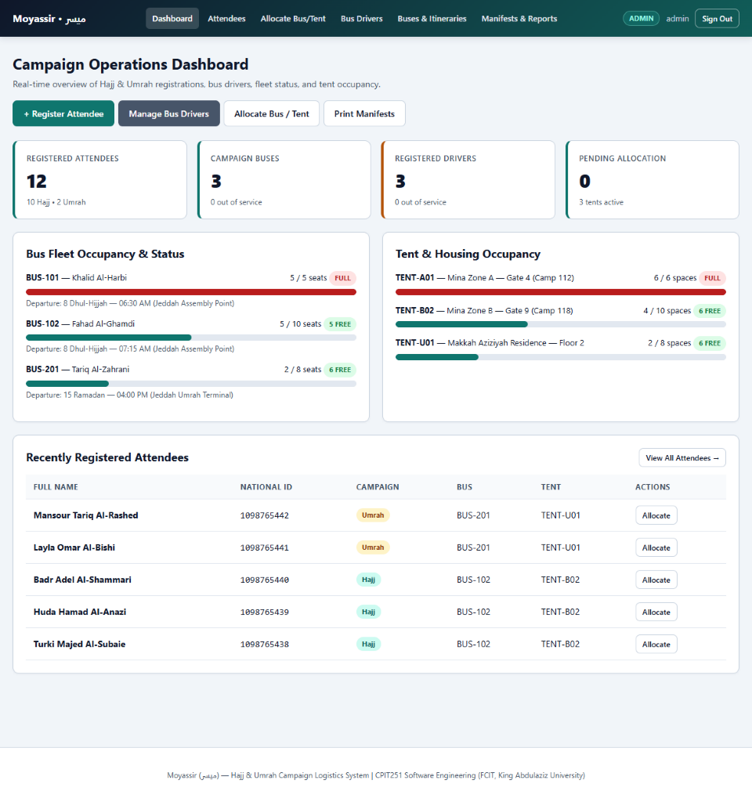
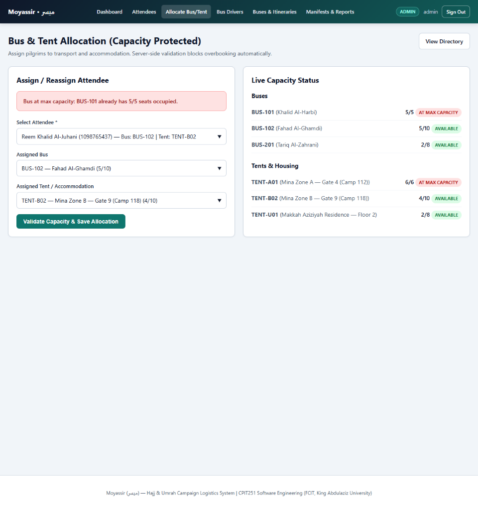
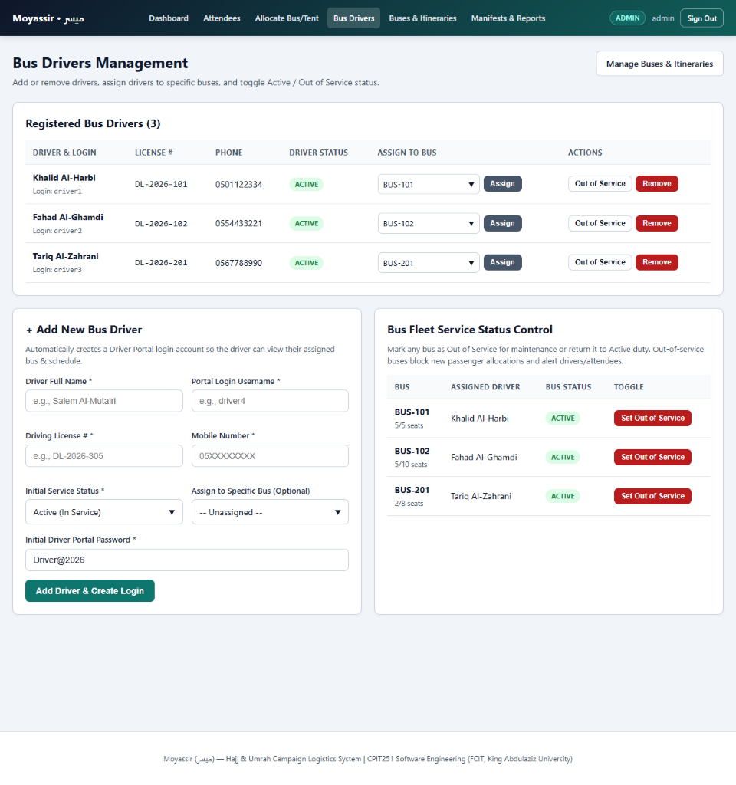
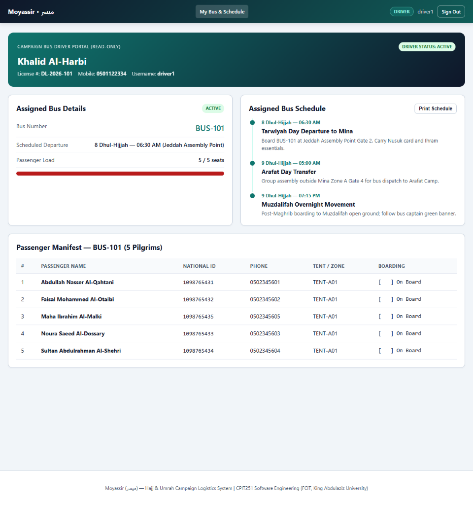

<div align="center">
  
  <h1>Moyassir (ميسر)</h1>
  <p><strong>Centralized Hajj &amp; Umrah Registration and Campaign Logistics System</strong></p>
  <p>
    <strong>Course:</strong> CPIT251 — Software Engineering (Section IT2) &bull;
    <strong>Supervisor:</strong> Prof. Mohammed J. Alhaddad<br>
    Faculty of Computing &amp; Information Technology (FCIT), King Abdulaziz University
  </p>
</div>

---

## Team Members

| # | Student Name | University ID |
|---|---|---|
| 1 | **Mohammed Aljedani** | `2435544` |
| 2 | **Omar Alofi** | `2436990` |
| 3 | **Saud Faisal Almesfer** | `2435484` |

---

## Project Deliverables (PDF Pack & Presentation)

Tap any document below to view it directly on GitHub:

| # | Deliverable | File Link |
|---|---|---|
| 01 | **Final Project Report (Chapters 1–7)** | [01_FINAL_PROJECT_REPORT.pdf](docs/pdf/01_FINAL_PROJECT_REPORT.pdf) |
| 02 | **Agile Scrum Execution (Sprints 0–4)** | [02_Sprints_0_to_4_Preview.pdf](docs/pdf/02_Sprints_0_to_4_Preview.pdf) |
| 03 | **Software Engineering Diagrams (ERD, DFD, Class, Flow, Deployment)** | [03_Software_Engineering_Diagrams.pdf](docs/pdf/03_Software_Engineering_Diagrams.pdf) |
| 04 | **UI Wireframes (9 Responsive Screens)** | [04_UI_Wireframes.pdf](docs/pdf/04_UI_Wireframes.pdf) |
| 05 | **Presentation & 5-Minute Live Demo Playbook** | [05_Presentation_and_Live_Demo_Playbook.pdf](docs/pdf/05_Presentation_and_Live_Demo_Playbook.pdf) |
| 06 | **Supporting Evidence Pack (Nusuk, GASTAT, Literature)** | [06_Supporting_Evidence_Pack.pdf](docs/pdf/06_Supporting_Evidence_Pack.pdf) |
| 07 | **Testing Cases & 17/17 Automated Results** | [07_Testing_Cases_and_Results.pdf](docs/pdf/07_Testing_Cases_and_Results.pdf) |
| 08 | **Presentation Slide Deck (16:9 PDF)** | [08_Moyassir_Presentation_Slides.pdf](docs/pdf/08_Moyassir_Presentation_Slides.pdf) |
| PPTX | **Editable PowerPoint Presentation** | [Moyassir_CPIT251_Presentation.pptx](Moyassir_CPIT251_Presentation.pptx) |

---

## System Overview

**Moyassir (ميسر)** is a centralized, role-based web application built with **PHP 8.2** and **SQLite 3 (via PHP PDO)** that transitions domestic Hajj & Umrah campaign operators from fragmented Excel sheets, paper lists, and scattered WhatsApp broadcasts to a normalized (3NF) relational single source of truth.

* **Campaign Managers (Admins):** Manage attendee registrations (atomic `USERS` + `ATTENDEES` creation), add/remove bus drivers, assign drivers `1:1` to buses, toggle `Active` / `Out of Service` fleet status, allocate buses & tents with strict server-side capacity guards, publish itineraries, search/filter records, and export printable manifests (PDF / CSV).
* **Bus Drivers:** Sign into a dedicated read-only **Driver Portal** to view their service status, assigned bus & live seat load, chronological itinerary milestones, and passenger boarding checklist.
* **Attendees (Pilgrims):** Sign into a mobile-friendly read-only **Pilgrim Pass Portal** to view their personal pass, assigned bus & driver phone number, Mina/Makkah tent zone, and live campaign schedule.

---

## Live UI Preview

| Admin Dashboard | Full-Bus Capacity Guard (`5/5`) |
|---|---|
|  |  |

| Bus Drivers & Service Control | Bus Driver Schedule Portal |
|---|---|
|  |  |

---

## Try It Locally (Zero Database Setup Required)

On first launch, [`src/classes/Database.php`](src/classes/Database.php) automatically creates `data/hajj_umrah.sqlite` and executes [`sql/schema.sql`](sql/schema.sql) + [`sql/seed.sql`](sql/seed.sql) with `PRAGMA foreign_keys = ON`.

### Option A — Standard PHP 8.1+ (macOS / Linux / Windows)
```bash
git clone https://github.com/0xMrHex/moyassir-cpit251.git
cd moyassir-cpit251
php -S 127.0.0.1:8088 -t src
```
*(On Windows with XAMPP where `php` is not in `PATH`:)*
```powershell
& 'C:\xampp\php\php.exe' -S 127.0.0.1:8088 -t src
```
Then open **`http://127.0.0.1:8088`** in your browser.

### Option B — Docker (One Command)
```bash
docker build -t moyassir . && docker run --rm -p 8088:8088 moyassir
```

### Run the 17-Case Automated Verification Suite
```bash
php src/tests/run_automated_tests.php http://127.0.0.1:8088
```

### Demo Credentials

| Portal Role | Username / National ID | Password |
|---|---|---|
| **Campaign Manager (Admin)** | `admin` | `Admin@2026` |
| **Bus Driver (Sample)** | `driver1` *(also `driver2`, `driver3`)* | `Driver@2026` |
| **Attendee / Pilgrim (Sample)** | `1098765431` *(through `1098765442`)* | `Pilgrim@2026` |

---

## Product Backlog (8 Core Functions — Exceeds Minimum 4)

| ID | Role | Core Function | Sprint |
|---|---|---|---|
| **US-01** | Admin / Driver / Attendee | Login & 3-Role Session Authentication (`bcrypt` + CSRF) | Sprint 2 |
| **US-02** | Admin | Attendee CRUD with Atomic Portal Account Creation | Sprint 2 |
| **US-03** | Admin | Bus & Tent Allocation with Server-Side Capacity & Status Guards | Sprint 2 |
| **US-04** | Admin | Multi-Criteria SQL Search & Filtering | Sprint 3 |
| **US-05** | Attendee | Mobile-Responsive Read-Only Pilgrim Pass Portal | Sprint 3 |
| **US-06** | Admin | Printable Bus Manifests & Tent Rosters (`@media print` PDF & CSV) | Sprint 3 |
| **US-07** | Admin | Buses, Tents & Live Itinerary Schedule Management | Sprint 3 |
| **US-08** | Admin / Driver | Bus Driver CRUD, `1:1` Bus Dispatch, `Out of Service` Control & Driver Portal | Sprint 4 |

---

## Repository Structure

```text
moyassir-cpit251/
├── README.md
├── Dockerfile                         # Optional 1-command PHP 8.2 + SQLite container
├── Moyassir_CPIT251_Presentation.pptx # 12-Slide Editable PowerPoint Deck
├── docs/
│   ├── FINAL_PROJECT_REPORT.md        # Complete Chapters 1–7 + References & Appendices
│   ├── PRESENTATION_AND_DEMO.md       # 12-Slide Deck Outline + 5-Min Live Demo Script
│   ├── pdf/                           # All 8 Submission-Ready PDF Deliverables
│   ├── sprints/                       # Sprint 0–4 Execution Previews & Reviews
│   ├── evidence/                      # Nusuk Analysis, GASTAT Open Data & Literature Review
│   ├── diagrams/                      # Wireframes, Screen Flow, ERD, DFD, Class & Deployment
│   └── testing/                       # 17 Test Cases, Automated Results & 7 UI Screenshots
├── sql/
│   ├── schema.sql                     # 6-Table 3NF SQLite 3 DDL (PK, FK, UNIQUE, CHECK, Indexes)
│   └── seed.sql                       # Seed Data (1 Admin, 3 Drivers, 12 Pilgrims, 3 Buses, 3 Tents)
└── src/
    ├── config/db.php                  # SQLite 3 PDO Configuration
    ├── classes/                       # OOP PHP Models (Database, User, Driver, Attendee, Bus, Tent, Itinerary, ReportGenerator)
    ├── includes/                      # Session RBAC Guards, CSRF Helpers, Header & Footer
    ├── assets/css/style.css           # Responsive Styling + Print Manifest Layout
    ├── admin/                         # Admin Dashboard, Attendee CRUD, Allocation, Drivers, Logistics, Reports
    ├── tests/run_automated_tests.php  # Automated HTTP Verification (17 / 17 Passed)
    └── index.php, login.php, logout.php, portal.php, driver_portal.php
```
