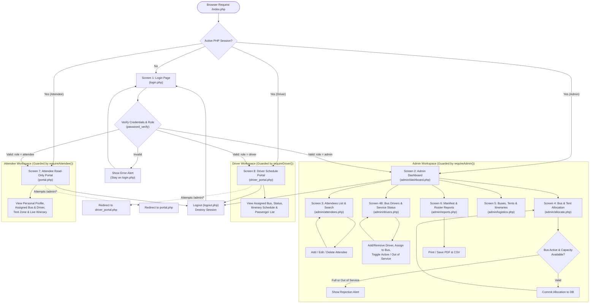

# Screen Flow Diagram — Moyassir (ميسر) Hajj & Umrah System

This diagram illustrates navigation paths, authentication guards (`auth_check.php`), and strict three-role separation between **Campaign Managers (Admins)**, **Bus Drivers**, and **Attendees (Pilgrims)**.

## Role Access Enforcement Matrix
| Screen / Route | Guest | Attendee | Driver | Admin |
|---|---|---|---|---|
| `/login.php` | Allowed | Redirects to `portal.php` | Redirects to `driver_portal.php` | Redirects to `admin/dashboard.php` |
| `/portal.php` | Redirects to `login.php` | **Allowed (Read-Only)** | Redirects to `driver_portal.php` | Redirects to `admin/dashboard.php` |
| `/driver_portal.php` | Redirects to `login.php` | **Blocked** | **Allowed (Read-Only)** | **Blocked** |
| `/admin/*` (Dashboard, Attendees, Allocate, Drivers, Logistics, Reports) | Redirects to `login.php` | **Blocked** | **Blocked** | **Allowed** |
