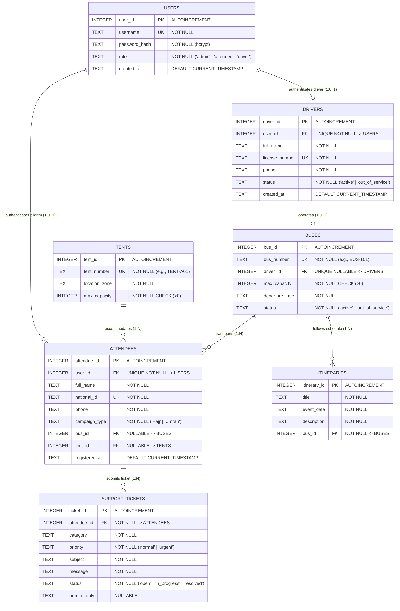

# Entity-Relationship Diagram (ERD) & Data Dictionary

The relational schema consists of **7 normalized (3NF) tables** implemented in **SQLite 3 via PHP PDO** (`sql/schema.sql`) with `PRAGMA foreign_keys = ON`.

## Cardinality & Referential Integrity Rules
1. **`USERS` (1) ↔ (0..1) `ATTENDEES` / `DRIVERS`:** Every attendee and every bus driver has exactly one linked login account (`ON DELETE CASCADE`).
2. **`DRIVERS` (1) ↔ (0..1) `BUSES`:** Enforced by `BUSES.driver_id UNIQUE` (`ON DELETE SET NULL`), guaranteeing one driver cannot be double-booked across two buses simultaneously and removing a driver never deletes the bus or its passengers.
3. **`BUSES` & `DRIVERS` Service Status:** Both tables enforce `CHECK (status IN ('active', 'out_of_service'))`. Out-of-service drivers cannot be assigned to buses, and out-of-service buses block new passenger allocations while alerting both drivers and attendees.
4. **`BUSES` / `TENTS` (1) ↔ (0..N) `ATTENDEES`:** Enforced via server-side capacity checks against `max_capacity`.
5. **`BUSES` (1) ↔ (0..N) `ITINERARIES`:** Each bus carries scheduled itinerary events displayed live on both the Driver Portal and Attendee Portal (`ON DELETE CASCADE`).
6. **`ATTENDEES` (1) ↔ (0..N) `SUPPORT_TICKETS`:** Pilgrims submit structured customer support messages linked via `attendee_id` (`ON DELETE CASCADE`), allowing Campaign Administrators to inspect assigned bus/tent context, update status, and post official replies without data duplication.
