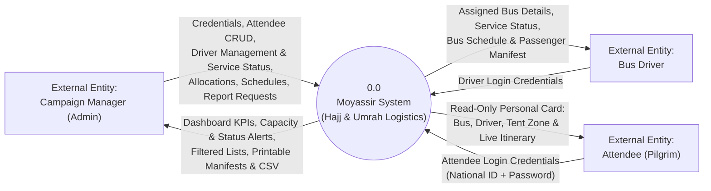
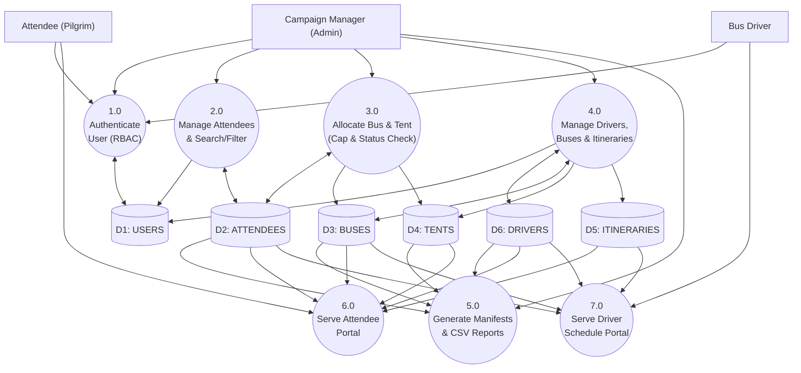

# Data Flow Diagrams (DFD) — Level 0 & Level 1

## 1. Level 0 DFD (Context Diagram)
Shows the **Moyassir (ميسر) System** interacting with its three external entities: **Campaign Manager (Admin)**, **Bus Driver**, and **Attendee (Pilgrim)**.

---

## 2. Level 1 DFD (Detailed Functional Decomposition)

