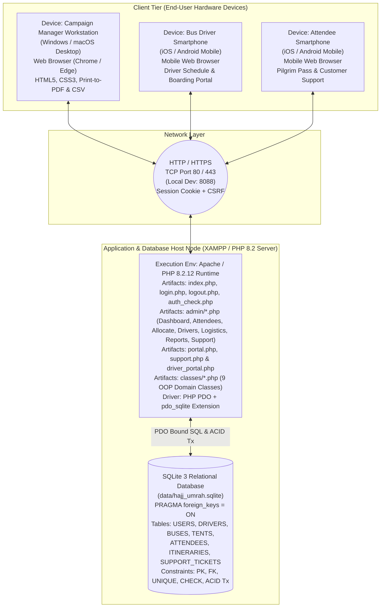

# UML Deployment Diagram — Physical System Architecture

Illustrates the physical hardware nodes, client devices, network protocol, PHP web server runtime, PDO database driver, and persistent relational SQLite 3 storage tier.

## Physical Node Specifications (Verified on Project Workstation)
1. **Client Nodes:** Desktop browsers (Admin operations dashboard, driver/bus controls, manifest printing) and mobile browsers (Bus Driver schedule portal and Pilgrim read-only pass portal in Mina/Arafat). Zero client installation required.
2. **Application Server Node:** Host running **XAMPP (Apache / PHP 8.2.12 x64)** with server-side PHP sessions, role-based access guards (`admin`, `driver`, `attendee`), and `pdo_sqlite`.
3. **Relational Storage Tier:** Embedded **SQLite 3** relational database (`data/hajj_umrah.sqlite`) initialized from `sql/schema.sql` and `sql/seed.sql` with `PRAGMA foreign_keys = ON`, enforcing all 7 normalized 3NF tables, `UNIQUE` and `CHECK` constraints, and ACID transactions.
4. **Security Controls:** Prepared statements with named bound parameters (`PDOStatement::bindValue`) on 100% of SQL queries, `bcrypt` (`password_hash`) credential storage, session ID regeneration on login, and CSRF token verification on all POST actions.
